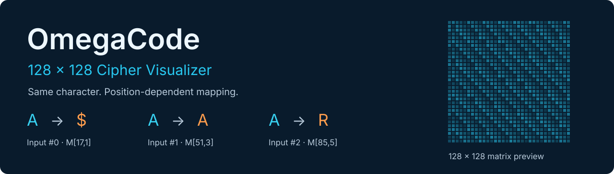
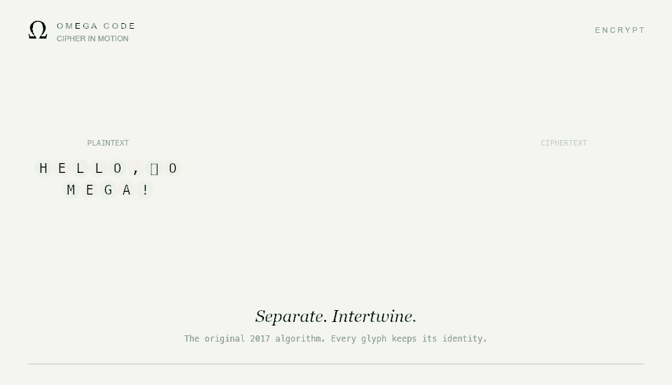

<div align="center">



**An old cryptography experiment. A continuous piece of motion.**

A dependency-free, animated interpretation of the original OmegaCode algorithm.
Characters separate, intertwine, pass through a living matrix, and gather into a secret.
Then the paths unravel, returning to the original words.

[Open the demo](#try-it) · [How it works](docs/algorithm.md) · [The original Java](src/omegaCode)

</div>



## Try it

Open **[`demo/index.html`](demo/index.html)** in a modern browser. It works offline: no install, account, API, or build step.

For a local preview with Node.js 20 or newer:

```sh
npm run preview
```

Then open **http://127.0.0.1:4173**. The preview serves only the demo files and listens only on your computer.

1. Enter your text and choose **开始演绎**.
2. Watch one uninterrupted, 26-second animation. Pause or scrub the timeline whenever you like.
3. See each glyph keep its identity as its position and value change.
4. At the result, choose **沿原路返回 · 解密** to watch the reverse journey.
5. To revisit it later, copy the complete decryption bundle. It includes **the ciphertext and both secret key values**.

The interface is in Chinese, with Encode/Decode labels. **␠** denotes a space; **◇** denotes one UTF-16 surrogate unit, such as half of an emoji. Long messages are fully computed, with up to 40 sampled trajectories shown to keep the animation legible.

## What you can see

| Encode | Decode |
| --- | --- |
| Split text into Java-compatible UTF-16 units | Read the ciphertext and its keys |
| Generate 64 character seeds and 64 indexes | Divide the key pack to recover the indexes |
| Build the 64 × 64 matrix | Rebuild the same matrix |
| Move characters through odd/even shuffles | Reverse each character substitution |
| Trace each matrix lookup and substitution | Interleave the characters back into place |
| Inspect the ciphertext and key bundle | Compare the recovered text with the original |

The animation uses actual intermediate results. It continuously choreographs the first two shuffle rounds and the exact final permutation, then moves every visible glyph through its actual matrix lookup. Fast-forwarding uses permutation cycles; it does not approximate the cipher.

The same renderer draws both the browser animation and the 24-fps preview above. The preview shortens each direction to 15 seconds. The browser and the unmodified Java implementation have been compared on 11 reference cases.

## A preserved experiment

OmegaCode began in **May 2017** as a small Java cryptography project. The original three Java files remain unchanged in `src/omegaCode/`. The interactive edition lives alongside them.

This is an **educational cipher**, with its original quirks visible:

- Random material uses `Math.random()`, not a cryptographic random generator.
- Characters above the selected matrix value pass through unchanged.
- The substitution schedule repeats every 64 character positions.
- Non-ASCII units participate in shuffling but pass through the substitution.
- The algorithm does not authenticate ciphertext or detect a plausible but incorrect key.
- Control characters can fail to round-trip. The interactive page rejects them and caps input at 256 UTF-16 units.

Do not use this algorithm to protect real secrets. The decryption bundle contains the private key; it is a convenient demo format, not a secure sharing format. All demo computation stays in the page, and message/key data is never saved in conversation state or browser storage.

For emoji, the original shuffle can separate a surrogate pair. Use the complete JSON bundle to preserve those units when copying; copying a rendered raw ciphertext through another application may lose them.

## Verify it

No dependencies are required for the normal test suite:

```sh
npm test
npm run check
```

Tests cover all 9,025 printable-ASCII character/key combinations, odd/even shuffling, exact fast-forward, 64-unit boundaries, key parsing, Unicode, bundles, and fixtures produced by the original Java classes. Motion tests verify correct final glyphs, continuous handovers, and trajectories that stay inside mobile and desktop canvases.

To compare fresh randomly generated cases against the original code, install JDK 11+ and run:

```sh
npm run verify:java
```

Set `JAVA_HOME` if your JDK is not on `PATH`. This compiles into a temporary directory and removes the generated classes afterwards.

## Inside the repository

```text
src/omegaCode/          Original 2017 Java implementation, preserved
demo/omega.js          Faithful algorithm port and intermediate data
demo/motion.js         Deterministic trajectories and the shared canvas renderer
demo/film.js           Playback, timing, input, and local interaction
demo/index.html        Offline entry point
demo/*.css             Responsive layout and light/dark themes
tests/                 Reference fixtures, Java oracle, and regression tests
scripts/               Local preview, parity check, and inline-preview bundler
docs/                  Algorithm notes and preview assets
```

The animation respects reduced-motion preferences. Message text and keys never leave the page or enter saved conversation state.
